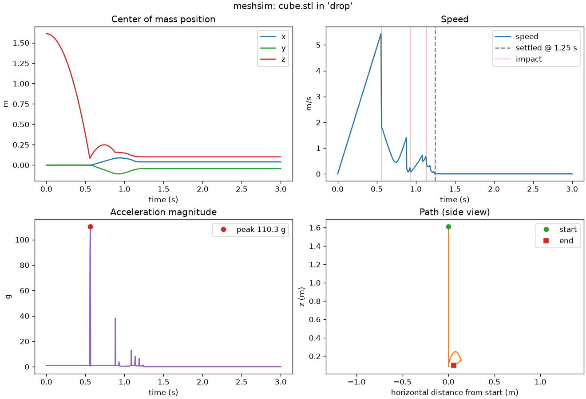
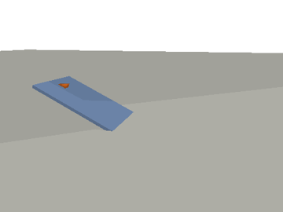

# meshsim

[](https://github.com/armaan-crypto/meshsim/actions/workflows/ci.yml)
[](https://github.com/armaan-crypto/meshsim/blob/main/LICENSE)

Physics-based testing for 3D designs. Load a mesh, put it in an environment
(flat ground, a ramp, a drop test, or terrain from a heightmap or scan), run a
rigid-body simulation, and get numbers and pictures back.

> **Status: early (v0.1, pre-alpha).** The features below work and are tested,
> but the API may change and the physics is rigid-body only. See
> [Known limitations](#known-limitations) before trusting a number.

## What it does

- Loads STL, OBJ and PLY meshes (STEP with an optional extra), cleans them up,
  and computes mass, center of mass and inertia from the geometry and a density
  (or a mass you set).
- Simulates the part as a rigid body with [PyBullet](https://pybullet.org) in one
  of four environments: `flat`, `ramp`, `drop`, `terrain`.
- Writes a trajectory CSV, a metrics JSON (peak acceleration, peak impact
  velocity, settle time, final pose, tilt, distance traveled), a PNG plot, and
  optionally a GIF or MP4 animation.
- Computes static tip-over angles with `meshsim stability`, without a simulation.
- Works the same from the command line and from Python.

## Who it is for

Engineers, makers and students who want a quick, scriptable answer to questions
like "does this part slide on a 25° slope?", "how fast is it going when it hits
the floor from 1.5 m?" or "where does it come to rest?" without setting up a
full physics or FEA package. Every default works out of the box, and every
parameter (gravity, timestep, friction, restitution, density, environment
geometry, ...) can be changed.

## Install

Requires Python 3.10+. meshsim is not on PyPI yet; install from GitHub:

```bash
pip install "git+https://github.com/armaan-crypto/meshsim"
```

Optional extras: `[video]` for MP4 output (imageio + ffmpeg), `[step]` for STEP
files (cascadio), `[mcp]` for the MCP server (official `mcp` SDK), `[dev]` for tests
and linting.

```bash
git clone https://github.com/armaan-crypto/meshsim && cd meshsim
pip install -e ".[dev,video]"
```

**macOS on Apple Silicon:** PyBullet ships no prebuilt wheel there, so pip
compiles it, which takes a few minutes. With the macOS 15 SDK that build fails in
PyBullet's bundled zlib; this flag works around it:

```bash
CFLAGS="-Dfdopen=fdopen" pip install pybullet
```

PyBullet also has no Linux wheel for Python 3.12 yet, so it is built from source
there too (this works without extra flags).

## Quickstart

```bash
meshsim run part.stl                                      # rest on flat ground for 5 s
meshsim run part.stl --env ramp -p angle=25 --friction 0.3 --duration 5
meshsim run part.stl --env drop -p height=1.5 --render     # adds render.gif
meshsim run part_mm.stl --scale 0.001 --density 2700       # mm STL, aluminium
meshsim stability part.stl                                # tip-over angles, no simulation
meshsim envs                                              # list environments and parameters
```

Results go to `meshsim_output/` (change with `--out`).

### Python API

```python
from meshsim import Simulation

result = Simulation("part.stl", env="ramp", duration=5, env_params={"angle": 25}, friction=0.3).run()
print(result.metrics["settle_time_s"], result.metrics["total_distance_m"])
result.save("out/")  # trajectory.csv, metrics.json, plot.png
```

`Simulation(model, config=None, **overrides)` takes a mesh path or a
`trimesh.Trimesh`, an optional config (a `SimConfig`, a dict, or a YAML path), and
keyword overrides for any config field. `env` can also be an `Environment`
instance, e.g. `Terrain(heightmap=my_numpy_array, cell_size=0.5)`.

### Use it from Claude

The repo includes a [Claude Code skill](https://github.com/armaan-crypto/meshsim/blob/main/.claude/skills/meshsim/SKILL.md) that
teaches Claude to run meshsim for you. Ask a physical question about a model in
plain language, for example "drop phone_case.stl from 1.2 m in TPU, how fast
does it hit?". Claude then:
- checks the mesh's units, closedness and shape with a bundled helper script
- picks the environment and material values
- runs the simulation and sanity-checks the result against simple physics
- explains the answer with the relevant caveats

The skill loads automatically when Claude Code runs inside this repo. To use it
in any project, copy the folder to your personal skills directory:

```bash
cp -r .claude/skills/meshsim ~/.claude/skills/
```

Its test cases live in `.claude/skills/meshsim/evals/`. In Claude Code you can
run them with `claude plugin eval .claude/skills/meshsim --scaffold --allow-tools Write,Edit,Bash`.
These are real model runs and are billed.

### Use it from any MCP client

`meshsim mcp` serves meshsim over stdio to Claude Desktop, Cursor and other
[MCP](https://modelcontextprotocol.io) clients. Install the extra first:

```bash
pip install "meshsim[mcp] @ git+https://github.com/armaan-crypto/meshsim"
```

For Claude Code:

```bash
claude mcp add meshsim -- meshsim mcp
```

For Claude Desktop, add this to `claude_desktop_config.json`. If `meshsim` is not
on the PATH Claude Desktop sees, use its full path as `command`:

```json
{
  "mcpServers": {
    "meshsim": { "command": "meshsim", "args": ["mcp"] }
  }
}
```

| Tool | What it does |
| --- | --- |
| `inspect_mesh(path, scale)` | Likely units and suggested scale; watertight, concave and flat-bottom flags |
| `list_environments()` | The same content as `meshsim envs` |
| `run_simulation(path, env, env_params, duration, scale, density, mass, friction, restitution, orientation, velocity, timestep, render, out_dir)` | Runs and saves a simulation; returns the metrics and the output file paths |

Give absolute paths: the client decides the server's working directory. Without
`out_dir`, each run gets a new folder under `./meshsim_output/`. Invalid inputs
come back as tool errors with the same messages as the CLI.

## Example output

`python examples/cube_drop.py`: a 20 cm aluminium cube dropped from 1.5 m,
tilted a few degrees. The run reports first contact at 0.558 s (theory
√(2h/g) = 0.553 s) and impact speed 5.44 m/s (theory √(2gh) = 5.42 m/s).



`examples/wedge_ramp.py` with friction 0.15: a wedge sliding down a 25° ramp
onto the floor (GIF written with `--render`).



## Environments

| Name | What it is | Main parameters (defaults) |
|---|---|---|
| `flat` | Horizontal ground at z=0; the part starts resting on it | `friction` (1.0), `restitution` (1.0), `clearance` (0.001 m) |
| `ramp` | Inclined plank whose bottom edge meets flat ground at x=0; parts slide toward +X | `angle` (20°), `friction` (1.0), `length` (5 m), `width` (2 m), `start_distance` (4 m) |
| `drop` | Free fall onto a flat floor | `height` (1.0 m, lowest point to floor), `friction`, `restitution` |
| `terrain` | Static terrain from a heightmap (`.npy`, `.csv`, `.txt`, grayscale image, or array) or a terrain mesh (`.stl`, `.obj`, `.ply`) | `heightmap` or `mesh`, `cell_size` (1 m), `height_scale` (1.0), `mesh_scale`, `spawn_x`, `spawn_y`, `spawn_height` |

Pass environment parameters with `-p key=value` (repeatable) or under
`env_params:` in YAML. Run `meshsim envs` for the full list.

Contact friction and restitution in Bullet are the **product** of the two
surfaces' values. Environment surfaces default to 1.0, so by default the part's
own `friction` and `restitution` are the effective values. Setting a surface
value (e.g. `-p friction=0.5` on the ramp) scales them.

## Stability

`meshsim stability` answers "how far can this tilt before it tips?" from geometry
alone. It finds the support polygon of the part in its resting pose and, for each
direction, the tilt at which the vertical through the center of mass leaves that
polygon: tan θ = distance to the edge / center-of-mass height.

```bash
meshsim stability part_mm.stl --scale 0.001 --density 1240
meshsim stability stand.stl --scale 0.001 --density 1240 --add-mass 0.2 --at 0 0.03 0.06 --json stability.json
meshsim stability part.stl --list-poses   # which way up will it land? needs pip install 'meshsim[poses]'
```

It prints the minimum tip angle and its direction, the angle in each of
`--directions` evenly spaced directions, the center-of-mass height and the size of
the support polygon. Azimuths are measured from +X toward +Y and name the way the
part tips. `--add-mass` adds one point mass at `--at`, given in meters along the
part's own axes after `--scale`. A part that has no support area, or whose center
of mass is outside it, is reported as unable to rest in that pose.

From Python: `meshsim.tip_angles(mesh, ...)` and `meshsim.stable_poses(mesh, ...)`.

The angle is a static estimate. It ignores dynamics, so a push or a bounce can tip
a part below it, and it assumes the part doesn't slide first (sliding needs
tan θ above the friction coefficient). To test a push, use a `flat` run with
`--velocity` and read `tipped_over` and `max_tilt_deg` from `metrics.json`:

- `max_tilt_deg` is the largest angle between the part's starting up axis and its
  current one. Spin about that axis doesn't count.
- `tipped_over` is true when the part ends more than `tip_threshold` degrees
  (default 45) from its starting up axis.

Both are relative to how the part started. On a `ramp`, a part that slides
onto the flat run-out turns by the ramp angle without tipping, so check the plot
for steep ramps.

## Configuration

Every setting can come from a YAML file, CLI flags, or Python keyword
arguments. Precedence: defaults < YAML < flags/keywords.

```yaml
# meshsim run part.stl --config test.yaml
env: ramp
env_params: {angle: 25, length: 3.0}
duration: 5.0          # s
timestep: 0.0041667    # s (1/240 is PyBullet's tuned default)
gravity: 9.81          # m/s^2, along -Z
scale: 1.0             # mesh units -> meters (0.001 for mm)
density: 1200          # kg/m^3 (ignored if mass is set)
mass: null             # kg
friction: 0.3
restitution: 0.1
initial_orientation: [0, 0, 0]   # roll, pitch, yaw, degrees
initial_velocity: [0, 0, 0]      # m/s
render: false
render_format: gif     # or mp4 (needs the [video] extra)
```

Also available: `linear_damping`, `angular_damping`, `settle_speed`,
`settle_angular_speed`, `settle_window`, `tip_threshold`, `render_fps`,
`render_size`, `plot`, `output_dir`. See [`src/meshsim/config.py`](https://github.com/armaan-crypto/meshsim/blob/main/src/meshsim/config.py) for what each
one does. Unknown keys and invalid values are rejected with an error.

## Outputs

| File | Contents |
|---|---|
| `trajectory.csv` | One row per physics step: time, center-of-mass position, orientation quaternion (of the original mesh axes), linear and angular velocity, speed, acceleration, contact flag |
| `metrics.json` | Model info (mass, volume, inertia, watertightness), environment, full config, and metrics: `peak_acceleration_m_s2`/`_g`, `peak_impact_velocity_m_s`, `first_contact_time_s`, `impact_count`, `settle_time_s`, `final_position_m`, `final_orientation_quat_xyzw`/`_euler_deg`, `max_tilt_deg`, `tipped_over`, `total_distance_m`, `net_displacement_m`, `max_speed_m_s` |
| `plot.png` | Position, speed (with impacts and settle time marked), acceleration, and a side-view path |
| `render.gif` / `render.mp4` | Optional animation, rendered with PyBullet's CPU renderer (no GPU or display needed) |

## How it works

1. **Mesh**: [trimesh](https://trimesh.org) loads the file, merges duplicate
   vertices, drops degenerate and duplicate faces and fixes winding. Volume,
   center of mass and the inertia tensor come from the closed mesh and the
   density. The body frame is placed at the center of mass along the principal
   axes, so PyBullet gets an exact diagonal inertia.
2. **Collision**: the part collides as its convex hull (see limitations).
   Environments are static PyBullet bodies: planes, boxes, heightfields, or
   concave triangle meshes for terrain.
3. **Simulation**: PyBullet steps the world at a fixed timestep (default 1/240 s)
   in headless `DIRECT` mode. Damping defaults to zero, unlike PyBullet's own
   default, so free fall matches the textbook result.
4. **Metrics**: computed from the recorded trajectory. Acceleration is the
   finite difference of velocity. An impact is a step where contact starts while
   the part is moving; its velocity is the speed just before contact. Settle time
   is when linear and angular speed drop below thresholds and stay there for at
   least `settle_window` seconds.
5. **Render**: after the run, recorded poses are replayed and captured with
   PyBullet's software renderer.

The test suite checks the physics against closed-form results: free-fall time
√(2h/g) and impact speed √(2gh) within 2%, and sliding speed on a ramp
g(sin θ − μ cos θ)·t within 5%. Static tip angles match atan(half base / center-of-mass
height), and a box on a high-friction ramp stays up 2.4° below its computed tip angle and
tips 2.6° above it.

## Known limitations

- **Convex hull collision.** Concave parts (a cup, an L-bracket) collide as if
  their hollows were filled. Mass and inertia still use the real shape when the
  mesh is watertight.
- **Non-watertight meshes** fall back to the convex hull for volume, mass and
  inertia, with a warning.
- **Perfectly flat impacts.** When a flat face lands exactly parallel to the
  floor with restitution > 0, Bullet resolves the bounce at a single corner on
  the first contact step, which adds spurious spin. Real drops are rarely
  perfectly flat; a tilt of a few degrees (`--orientation 4 3 0`) avoids it.
- **Thin parts and fast impacts need a smaller timestep.** A part moves
  `speed × timestep` per step (2 cm at 5 m/s with the default 1/240 s). When
  that approaches the part's thickness, it sinks into the floor on impact and
  bounces become unreliable. Use `--timestep 0.001` and check the result
  doesn't change when you halve it again.
- **Peak acceleration during impacts** depends on the timestep and the contact
  model of a rigid-body solver. Use it to compare designs under the same
  settings, not as an absolute shock value.
- **Rigid bodies only.** No deformation, stress, fluids or heat (see roadmap).
- **STEP import** relies on the optional `cascadio` package and is not covered by
  tests yet.
- Units are SI. Meshes in millimeters need `--scale 0.001`. Z is up.

## Roadmap

Planned, not built yet:

- Convex decomposition (V-HACD) so concave parts collide correctly
- Scan-to-environment import: point clouds and photogrammetry meshes to terrain,
  building on the existing heightmap and terrain-mesh loader
- Fluid solvers (drag, buoyancy, flow around a part)
- Thermal solvers
- FEA hooks: export contact forces and impact loads for structural solvers
- GPU acceleration for large parameter sweeps
- Parameter sweeps and batch runs from one config

## Contributing

Contributions are welcome, from bug reports to new environments. See
[CONTRIBUTING.md](https://github.com/armaan-crypto/meshsim/blob/main/CONTRIBUTING.md) for setup, tests and style, and look for
issues labeled
[good first issue](https://github.com/armaan-crypto/meshsim/labels/good%20first%20issue).
Please follow the [Code of Conduct](https://github.com/armaan-crypto/meshsim/blob/main/CODE_OF_CONDUCT.md).

## License

[Apache 2.0](https://github.com/armaan-crypto/meshsim/blob/main/LICENSE). Copyright 2026 Armaan.
